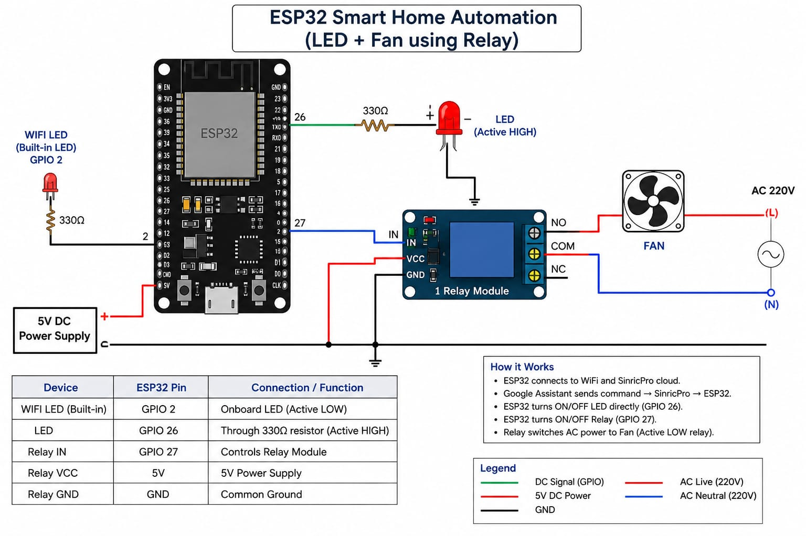

# Dual-Mode IoT Smart Home Controller: ESP32 + Sinric Pro (Alexa/Google Voice) & 38kHz IR Remote Failsafe


[](https://github.com/ParthDalakoti/esp32-sinric-iot-voice-automation/actions) [](https://wokwi.com)

[](https://www.espressif.com/)
[](https://sinric.pro/)
[]()
[]()
[](https://opensource.org/licenses/MIT)

> **IoT Firmware & Cloud Project | Graphic Era Hill University (B.Tech ECE 2023–2027)**  
> **Author:** Parth Dalakoti (*President, Robotics & Automation Club, GEHU*)  
> **Contact:** `parthdalakoti482@gmail.com` | [LinkedIn](https://linkedin.com/in/parthdalakoti)

---

## ⚡ Executive Summary

This project implements an industrial-grade **Dual-Mode Home Automation Controller** designed on the **ESP32** microcontroller:
1. **Cloud Voice Control:** Seamlessly pairs with Amazon Alexa and Google Assistant via the **Sinric Pro IoT Cloud** over secure WebSockets/MQTT.
2. **Local Infrared Failsafe:** Operates offline without internet dependency via a **38 kHz TSOP1738 IR receiver**, decoding NEC infrared remote signals for instant relay switching.
3. **Manual Bypass & State Memory:** Hardware toggle switches wired with internal pull-ups and non-volatile state synchronization prevent appliance downtime during network dropouts.

---

## ⚙️ System Architecture

```mermaid
graph TD
    subgraph Cloud_Layer [Cloud Control]
        Alexa[Amazon Alexa / Google Home] -->|Voice Intent| Sinric[Sinric Pro IoT Cloud]
        Sinric -->|Secure WebSockets / TLS| ESP32[ESP32 WROOM-32]
    end

    subgraph Local_Offline_Layer [Offline Failsafe Control]
        IR_Remote[38 kHz IR Remote] -->|NEC Protocol Pulses| TSOP[TSOP1738 IR Receiver]
        TSOP -->|GPIO Interrupt| ESP32
        Switch[Manual Wall Switches] -->|Debounced Logic| ESP32
    end

    subgraph Power_Actuation [Mains AC Actuation]
        ESP32 -->|Optocoupled Signals| Relays[4-Channel / 8-Channel Relay Module]
        Relays --> Light[Ceiling Lights]
        Relays --> Fan[Fan / Appliance]
        Relays --> AC[AC Heavy Loads]
    end
```



---

## 🛠️ Bill of Materials (BOM)

| Component | Model / Spec | Operating Voltage | Interface | Function |
| :--- | :--- | :--- | :--- | :--- |
| **Microcontroller** | ESP32-WROOM-32 (240 MHz Dual Core) | 3.3V Logic / 5V USB | Wi-Fi 802.11 b/g/n, GPIO | Central IoT firmware execution |
| **Relay Bank** | 4-Channel 5V Optocoupled Relay | 5V Coil / 250V AC 10A | Active LOW GPIO | AC Mains galvanic isolation & switching |
| **IR Demodulator** | TSOP1738 / VS1838B (38 kHz) | 5V | Digital Pulse Pin | Offline remote control decoding |
| **Power Supply** | 5V 2A Regulated Step-Down Module | 230V AC to 5V DC | Isolated Terminals | Embedded DC supply for logic & coils |

---

## 🔌 Hardware Pinout Matrix

| ESP32 Pin | Peripheral Connection | Function |
| :--- | :--- | :--- |
| **GPIO 15** | TSOP1738 Signal Out | 38 kHz Demodulated IR Input |
| **GPIO 23** | Relay Channel 1 | Appliance 1 (Living Room Lights) |
| **GPIO 22** | Relay Channel 2 | Appliance 2 (Fan / Motor) |
| **GPIO 21** | Relay Channel 3 | Appliance 3 (Auxiliary Plug) |
| **GPIO 19** | Relay Channel 4 | Appliance 4 (Night Lamp) |
| **GPIO 13** | Manual Push Switch 1 | Physical wall switch with software debounce |
| **GPIO 12** | Manual Push Switch 2 | Physical wall switch with software debounce |

---

## 🚀 Deployment & Flashing Guide

1. Clone repo: `git clone https://github.com/ParthDalakoti/esp32-sinric-iot-voice-automation.git`
2. Open [`firmware/esp32_sinric_voice_automation.ino`](firmware/esp32_sinric_voice_automation.ino).
3. Set your Wi-Fi credentials:
   ```cpp
   #define WIFI_SSID     "Your_WiFi_SSID"
   #define WIFI_PASS     "Your_WiFi_Password"
   #define APP_KEY       "YOUR_SINRIC_PRO_APP_KEY"
   #define APP_SECRET    "YOUR_SINRIC_PRO_APP_SECRET"
   ```
4. Flash using Arduino IDE (Target: *ESP32 Dev Module*).

---

## 👨‍💻 Engineering Author
**Parth Dalakoti**  
*B.Tech in Electronics & Communication Engineering (2023–2027)*  
*Graphic Era Hill University (GEHU), Bhimtal Campus*  
*President, Robotics & Automation Club, GEHU*

---

## 📸 Hardware Bench Test Photos



